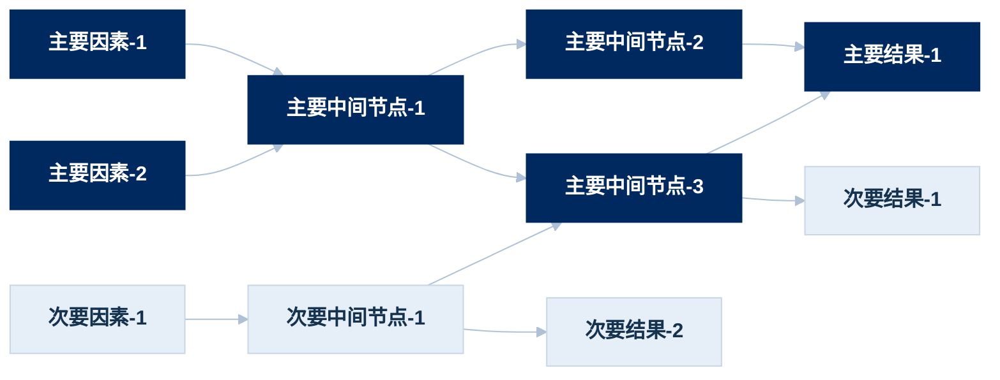

## 作图思路

参照图表请求，给对应的传导关系梳理清楚传导链路，并区分出主要驱动因素和次要驱动因素，用不同的颜色标记。

## 作图方法

1. 确立逻辑节点和逻辑关联：系统性寻找该传导链条的所有逻辑节点，包括主要因素、次要因素、中间的传导通道、主要的影响结果、次要的影响结果，每个节点文字不得超过14个字。
2. 按照Mermaid当中flowchart LR作图代码逻辑进行作图。须注意：生成的图片里不保留`主要原因`、`次要原因`、`主要中间节点`、`次要中间节点`、`主要结果`、`次要结果`这样的名称文字。
3. 按照以下方案（麦肯锡蓝）配色：

| 元素     | 底色        | 文字色       | 说明                        |
| ------ | --------- | --------- | ------------------------- |
| 主要逻辑节点 | `#002960` | `#FFFFFF` | 最深藏蓝                      |
| 次要逻辑节点 | `#E6EFF8` | `#15324F` | 统一浅蓝灰底 + 墨蓝字，描边 `#C7D6E6` |
| 连线     | `#AFC1D6` | —         | 灰蓝细线，压住视觉噪音               |

## 作图代码示例

