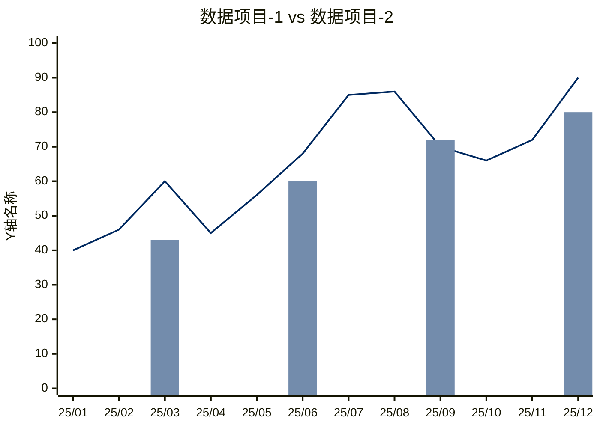

## 作图思路

参照图表请求，选定对应的数据项目（不超过3个），保存数据和数据来源，然后截取最能够表达该意图的数据范围。

## 作图方法

1. 确立数据项目：选定要探讨的数据项目和横轴的数据范围和数据频率，并检索数据保存下来。
2. 根据图表意图，框定适配于图标意图叙事的数据范围。
3. 确定所有的数据的值域在相同的范围内，即不存在任何一个项目，它的最大值比其他所有项目的最小值还小25%以上。如果存在不同范围内的数据，则只保留能够反应意图的数据项目。
4. 如果数据项目同频，则用折线图；如果不同频，则高频的用折线图表达，低频的用柱状图表达，其中低频的空缺数据用“Y轴范围的最小值-Y轴最大值与最小值差异的2%”替代，确保高频的数据项目编号靠前。
5. 因为Mermaid机能所限，柱状图数据项目最多只能有一个。
6. 按照Mermaid当中xychart-beta作图代码逻辑进行作图。须注意：生成的图片里不保留`Y轴名称`、`数据项目`这样的名称文字。
7. 按照以下方案（麦肯锡蓝）配色：

| 项目     | 填充色       |
| ------ | --------- |
| 数据项目-1 | `#002960` |
| 数据项目-2 | `#738CAC` |
| 数据项目-3 | `#E6EFF8` |

## 作图代码示例

