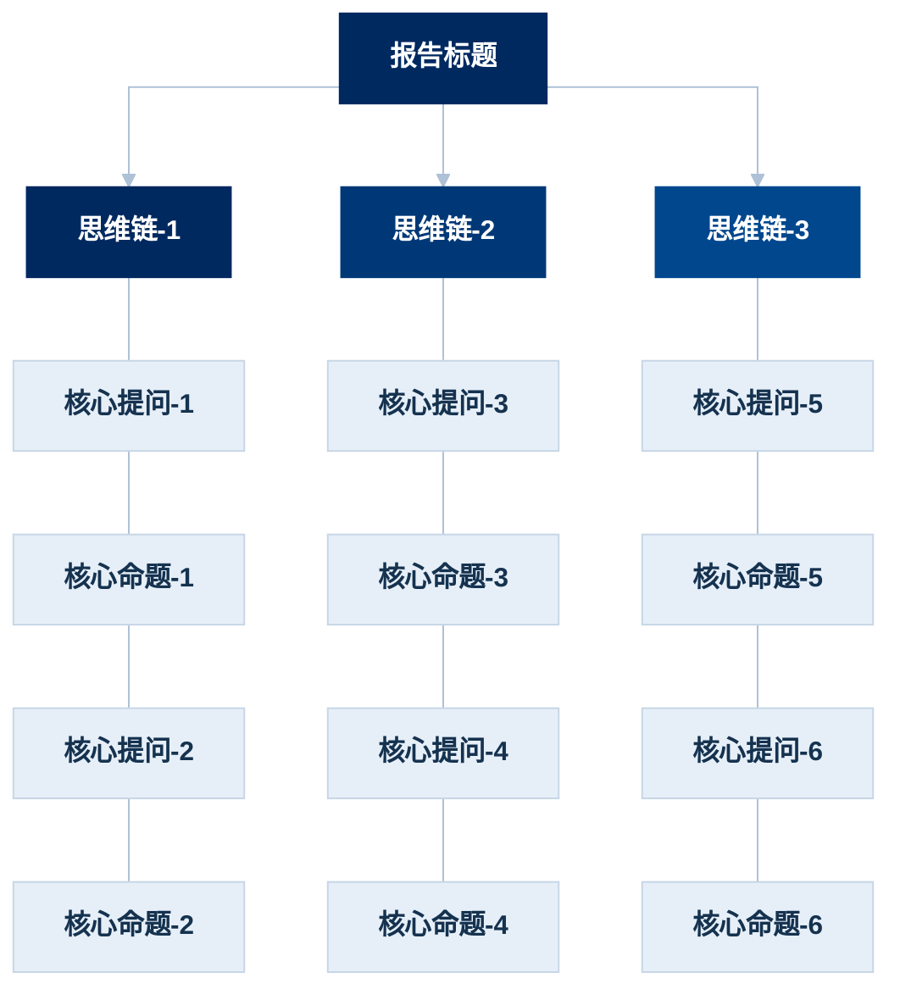

## 作图思路

用自上而下的流程图，由浅入深，提出问题并解答问题。

## 作图方法

1. 梳理独立思维链：把章节按照递进关系，由浅入深梳理成不同的链条（如果是广度优先，那么每个独立研究对象为一个链条，如果是深度优先，那么每个专题各为一个链条），每一个链条须解答“为什么要做这个方向的研究”这样的关键问题，并把答案提炼成10字以内的短语，命名为“思维链-X”。不超过4条思维链。
2. 梳理章节核心命题：把每一个章节的核心命题提炼出来，用短句的形式呈现，命名为“核心命题-Y”，并用一个简短的问题描述这个核心命题的研究价值在哪里，命名为“核心提问-Y”，提问的文字需要带问号。
3. 每个节点不得超过14个字。
4. 按照Mermaid当中flowchart TD作图代码逻辑进行作图。须注意：生成的图片里不保留`报告标题`、`思维链`、`核心提问`、`核心命题`这样的名称文字。
5. 按照以下方案（麦肯锡蓝）配色：

| 元素          | 底色        | 文字色       | 说明                        |
| ----------- | --------- | --------- | ------------------------- |
| 报告标题（根）     | `#002960` | `#FFFFFF` | McKinsey Deep Blue        |
| 思维链-1       | `#002960` | `#FFFFFF` | 最深藏蓝，等同根节点主标识色            |
| 思维链-2       | `#003877` | `#FFFFFF` | 蓝阶第 2 级                   |
| 思维链-3       | `#00478E` | `#FFFFFF` | 蓝阶第 3 级                   |
| 思维链-4       | `#0056A5` | `#FFFFFF` | 蓝阶第 4 级                   |
| 核心提问 / 核心命题 | `#E6EFF8` | `#15324F` | 统一浅蓝灰底 + 墨蓝字，描边 `#C7D6E6` |
| 连线          | `#AFC1D6` | —         | 灰蓝细线，压住视觉噪音               |

## 作图代码示例

