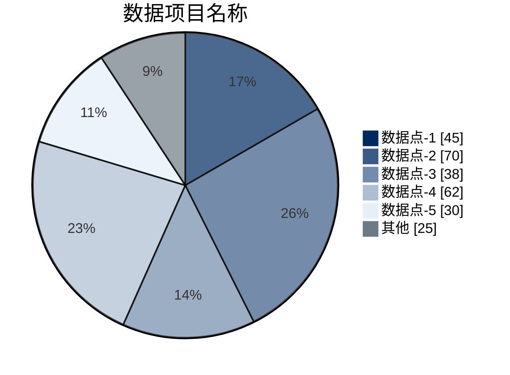

## 作图思路

参照图表请求，选定对应的数据项目，保存数据和数据来源，并根据数据点的多寡来敲定作图细节。

## 作图方法

1. 确立数据项目：选定要探讨的数据项目，并检索数据保存下来。
2. 如果数据点超过6个，则只保留该图表最需要探讨的5个数据（通常情形下是最大的5个数据，剩下的标为“其他”）
3. 按照Mermaid当中xychart-beta作图代码逻辑进行作图。须注意：生成的图片里不保留`数据项目名称`、`数据点`这样的名称文字。
4. 按照以下方案（麦肯锡蓝）配色：

| 项目    | 填充色       |
| ----- | --------- |
| 数据点-1 | `#002960` |
| 数据点-2 | `#3A5B86` |
| 数据点-3 | `#738CAC` |
| 数据点-4 | `#ADBED2` |
| 数据点-5 | `#E6EFF8` |
| 其他数据  | `#6E7A86` |

## 作图代码示例

